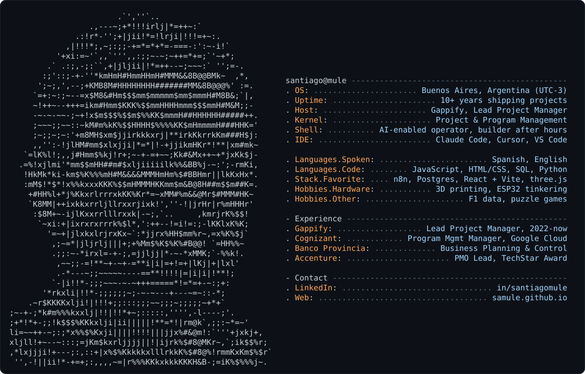

<picture>
  <source media="(prefers-color-scheme: dark)" srcset="assets/card-dark.svg">
  <source media="(prefers-color-scheme: light)" srcset="assets/card-light.svg">
  
</picture>

### hey, I'm Santiago 👋

By day I'm a **Lead Project Manager at [Gappify](https://www.gappify.com)**, taking enterprise SaaS rollouts from kickoff to go-live (ERP integrations, lots of stakeholders, the occasional fire).
By night I build small tools and toys, mostly with AI as my pair. This profile is where I build in public: half-finished things welcome.

### 🛠️ what I'm building

| project | what it is |
| --- | --- |
| [**f1-data**](https://github.com/samule/f1-data) | F1 apps on the free OpenF1 + Jolpica APIs: a lite race replay and a pit / strategy board |
| [**fog-clash**](https://github.com/samule/fog-clash) | a browser game in React + Vite, fresh out of the oven |
| [**monitor-inmobiliario**](https://github.com/samule/monitor-inmobiliario) | public report on the Buenos Aires property market, seven interactive charts |
| [**picross**](https://github.com/samule/picross) | nonogram puzzle game, React + Vite + Tailwind, playable on GitHub Pages |
| [**gallery-wall**](https://github.com/samule/gallery-wall) | plan a picture wall before you drill any holes, with a guided tour |
| [**closet-mgt**](https://github.com/samule/closet-mgt) | capsule-wardrobe helper: shopping guide + inventory checklist |
| [**claude-skills**](https://github.com/samule/claude-skills) | my personal collection of Claude skills |

**in the garage (private for now):** a motorcycle navigator on an ESP32 round display fed by the phone over BLE, an n8n bot that watches used-car prices and pings me when they drop, a Telegram bot that tracks what's in my storage unit, a 3D-printed shower door hinge (rev F and counting), and a three.js planner for a living-room remodel.

### 💼 the day job, briefly

- **Gappify**: Lead Project Manager (2022 to now)
- **Cognizant**: Program Management Manager on Google's Sovereign Cloud program (2021 to 2022)
- **Banco Provincia**: Business Planning & Control (2018 to 2021)
- **Accenture**: PMO Associate to PMO Lead, TechStar Award (2014 to 2018)

### 📫 say hi

[LinkedIn](https://www.linkedin.com/in/santiagomule/) · [samule.github.io](https://samule.github.io)
